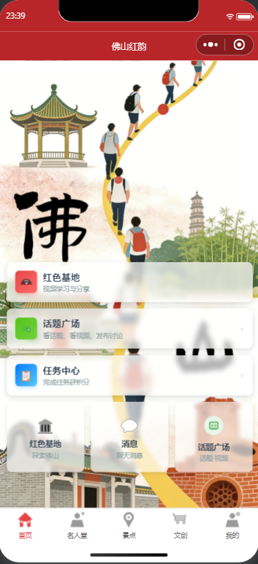
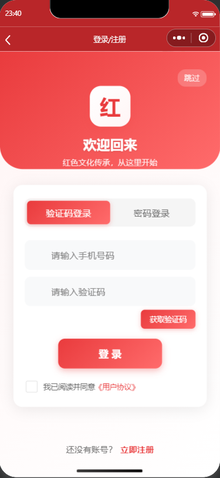
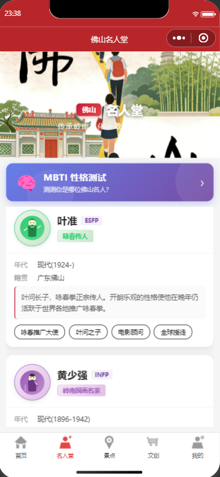
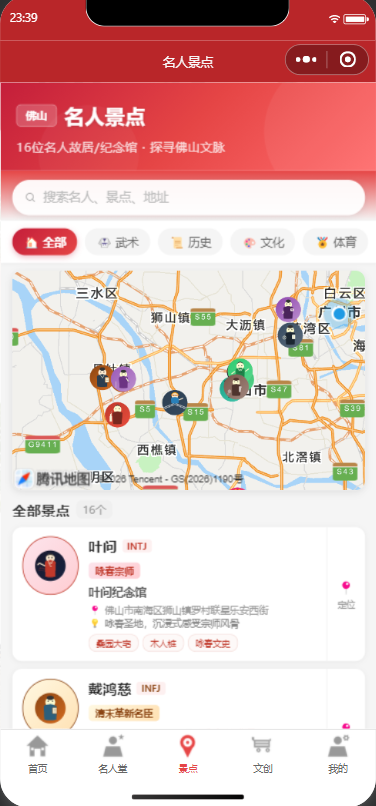
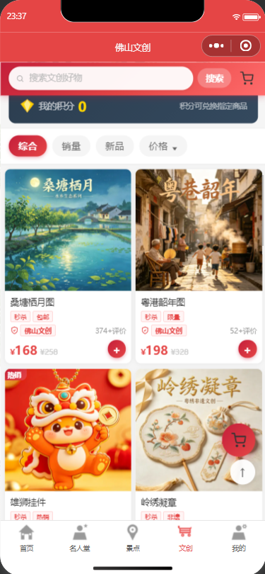
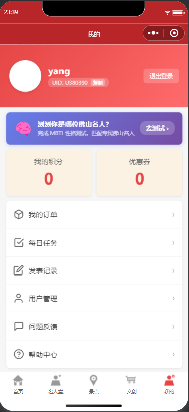

<div align="center">

# 佛山红韵

### 一站式佛山文化数字体验小程序

把佛山名人文化、名人故居、文旅景点、非遗文创与 MBTI 互动体验，装进一个轻量、易用的微信小程序。

[](https://developers.weixin.qq.com/miniprogram/dev/framework/)
[](https://developer.mozilla.org/docs/Web/JavaScript)
[](#数据说明)
[](#数据说明)

[产品预览](#产品预览) · [核心功能](#核心功能) · [运行项目](#运行项目) · [项目结构](#项目结构) · [数据说明](#数据说明)

</div>

---

## 项目简介

**佛山红韵** 是一个面向佛山文化传播与文创体验的微信小程序原型。

项目以“红色文化传承”和“佛山城市文化探索”为切入点，将地方名人、历史故事、文旅地图、非遗商品、积分任务和社区互动整合在一个完整的产品流程中。用户可以浏览名人堂、定位名人故居和景点、完成 MBTI 性格测试、购买佛山文创商品，并在社区中分享内容。

当前版本已经移除云开发依赖，所有演示数据通过微信小程序本地存储管理，适合课程展示、作品集演示、交互原型和后续产品迭代。

## 产品预览

### 首页

<div align="center">
  
</div>

首页作为佛山文化的统一入口，将红色基地、话题广场、任务中心和消息等核心功能集中展示，用户可以快速进入不同产品模块。

### 登录注册

<div align="center">
  
</div>

支持验证码登录、密码登录与新用户注册。登录后可以保存个人资料、查看积分和优惠券，并使用订单、发帖和聊天等需要账号的功能。

### 佛山名人堂

<div align="center">
  
</div>

名人堂集中展示佛山历史人物、人物简介、年代、籍贯和身份标签。用户还可以参与 MBTI 性格测试，匹配对应的佛山名人角色，以更轻松的方式了解地方文化。

### 名人景点地图

<div align="center">
  
</div>

景点地图将名人故居、纪念馆和文旅景点呈现在地图上，支持按人物、武术、历史、文化和体育等分类筛选，并提供搜索与景点介绍。

### 文创商店

<div align="center">
  
</div>

文创商店展示佛山非遗、手工艺、文创画册、纪念品和文具等商品，支持搜索、分类、销量、新品和价格排序，并接入积分、优惠券、购物车和订单流程。

### 个人中心

<div align="center">
  
</div>

个人中心集中管理用户资料、积分、优惠券、订单、每日任务、发表记录、问题反馈和帮助入口，是用户查看个人状态与使用记录的主要页面。

## 核心功能

### 01. 佛山文化探索

- 首页聚合红色基地、话题广场、任务中心、消息和个人中心入口。
- 名人堂展示佛山历史人物、人物简介、年代、籍贯、身份标签与代表故事。
- 景点地图支持按人物、武术、历史、文化和体育等分类筛选。
- 提供名人故居、纪念馆和文旅景点信息，帮助用户从人物故事走向城市探索。

### 02. 名人 IP 与 MBTI 互动

- 用户可以完成 MBTI 性格测试。
- 测试结果会匹配佛山名人角色，并展示人物类型、性格标签和人物介绍。
- 测试结果保存在本地，可在个人中心重复查看。
- 通过年轻化的互动方式降低地方历史文化的理解门槛。

### 03. 文创商城

- 展示佛山非遗、手工艺、文创画册、纪念品、文具和生活用品。
- 支持搜索、分类、销量、新品和价格排序。
- 支持商品详情、规格选择、收藏、加入购物车和立即购买。
- 支持积分兑换、优惠券领取、购物车数量管理和订单状态管理。

### 04. 社区与互动

- 红色文化内容浏览、话题发布、评论、点赞和收藏。
- 支持上传本地图片和视频素材进行内容分享。
- 好友申请、联系人列表、单聊消息和未读消息提醒。
- 任务中心通过浏览、发帖、签到等行为发放积分。

### 05. 个人中心

- 用户资料、UID、头像和昵称管理。
- 我的积分、积分记录、优惠券和订单。
- 每日任务、发表记录、问题反馈和帮助中心。
- 提供退出登录与本地账号切换能力。

## 产品流程

```text
登录 / 注册
    ↓
探索佛山文化
    ↓
名人堂 → MBTI 测试 → 名人匹配
    ↓
景点地图 → 名人故居 / 文旅景点
    ↓
文创商店 → 积分 / 优惠券 / 下单
    ↓
社区互动 → 发帖 / 评论 / 好友聊天
    ↓
个人中心 → 任务 / 订单 / 积分记录
```

## 技术栈

| 模块 | 技术 |
| --- | --- |
| 应用框架 | 微信小程序原生框架 |
| 页面结构 | WXML |
| 页面样式 | WXSS |
| 业务逻辑 | JavaScript ES6 |
| 数据存储 | `wx.getStorageSync` / `wx.setStorageSync` |
| 图片资源 | 本地 PNG / WebP |
| 后端依赖 | 无云函数、无远程数据库 |

## 项目结构

```text
weixin_APP1/
├─ 产品图片/                       # GitHub README 使用的产品界面图
│  ├─ 首页.png
│  ├─ 登录界面.png
│  ├─ 名人堂.png
│  ├─ 景点地图.png
│  ├─ 文创商店.png
│  └─ 个人界面.png
├─ webp/                           # 商品展示素材
├─ weixin_app/
│  ├─ miniprogram/
│  │  ├─ api/                      # 用户、积分、商城和聊天接口
│  │  ├─ pages/                    # 首页、登录、名人堂、景点、商城等主页面
│  │  ├─ subpackage_chat/          # 消息、联系人和聊天分包
│  │  ├─ subpackage_forum/         # 话题、视频、发帖和评论分包
│  │  ├─ subpackage_order/         # 支付和订单分包
│  │  ├─ subpackage_task/          # 任务中心分包
│  │  ├─ utils/                    # 本地数据层、商品数据和业务工具
│  │  ├─ images/                   # 图标、商品图和页面素材
│  │  ├─ app.js
│  │  └─ app.json
│  └─ project.config.json
├─ project.config.json
└─ README.md
```

## 运行项目

### 环境要求

- 微信开发者工具
- 微信小程序 AppID，或使用测试号
- 无需安装后端服务
- 无需配置云开发环境
- 无需执行数据库初始化脚本

### 启动步骤

1. 打开微信开发者工具。
2. 选择“导入项目”。
3. 选择本仓库根目录。
4. 填入自己的小程序 AppID，或选择测试号。
5. 点击编译即可运行。

### 演示登录

项目当前为本地演示模式：

- 验证码登录只校验验证码是否为空，输入任意非空验证码即可登录。
- 首次使用手机号登录会自动创建本地账号。
- 也可以先注册，再使用手机号和密码登录。
- 所有账号与业务数据仅保存在当前设备的微信小程序存储中。

## 数据说明

- 本项目不依赖云函数、云数据库或云存储。
- 账号、积分、优惠券、购物车、订单、帖子、评论、好友和聊天记录均保存在本地。
- 清理微信小程序缓存、卸载小程序或更换设备后，本地数据可能丢失。
- 用户选择的头像、图片和视频使用本机临时路径，清理缓存后可能无法继续访问。
- 当前数据层适合演示和原型验证，不适合直接作为线上生产系统的数据方案。

## 后续规划

- 接入正式用户体系和远程数据库。
- 增加持久化图片与视频存储。
- 完善订单支付、物流和售后流程。
- 丰富佛山名人、故居和景点内容。
- 增加内容审核、权限管理和运营后台。
- 优化无障碍体验、加载状态和弱网提示。

## 使用说明

本项目用于佛山文化传播、课程设计与产品原型展示。项目中的历史人物资料、商品图片、品牌名称和相关素材仅用于学习与演示，正式商用前请确认素材授权、人物资料准确性和相关平台规范。

---

<div align="center">

**佛山红韵**

让城市文化被看见，也被参与。

</div>
